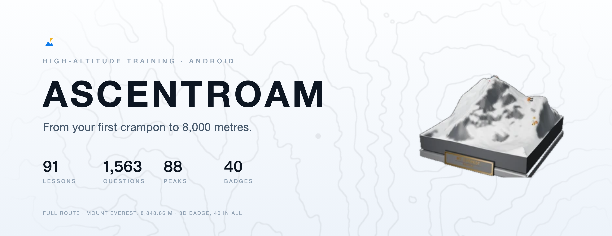
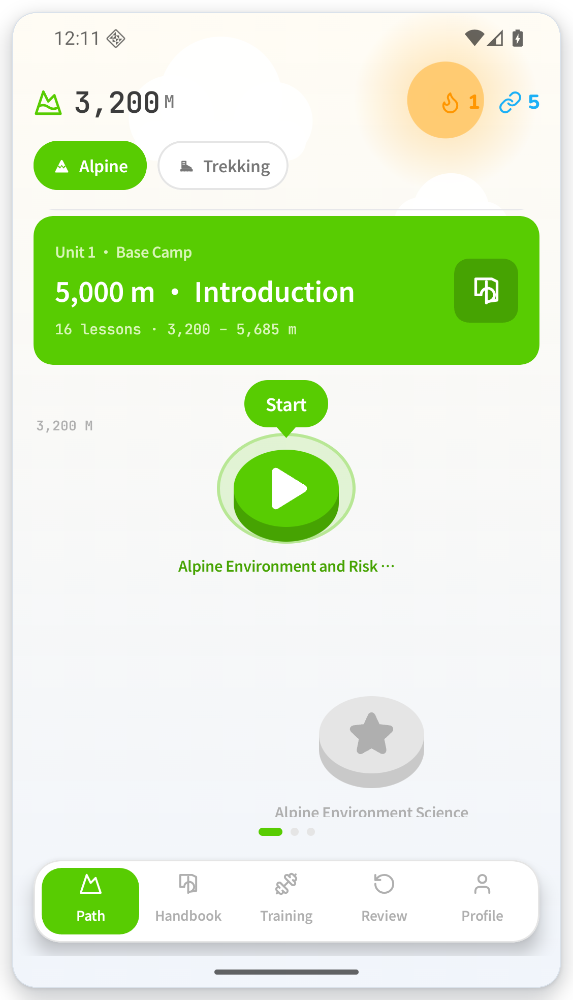
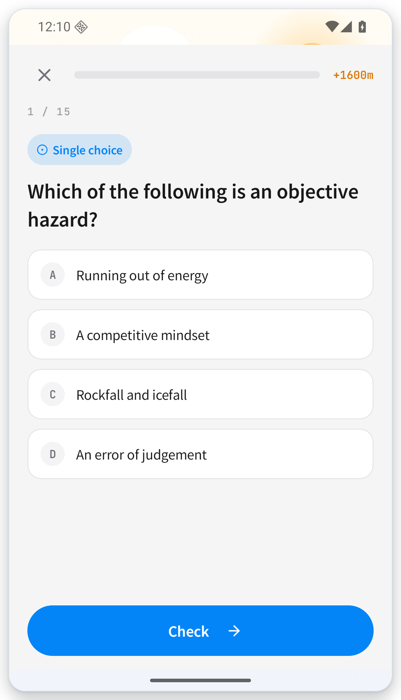
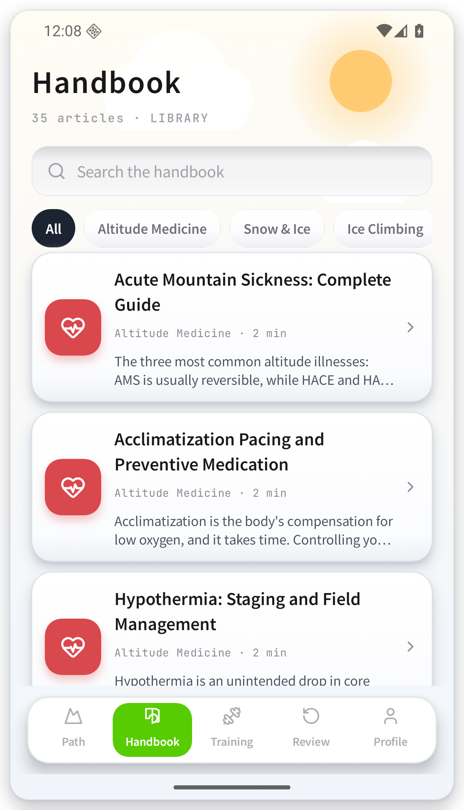
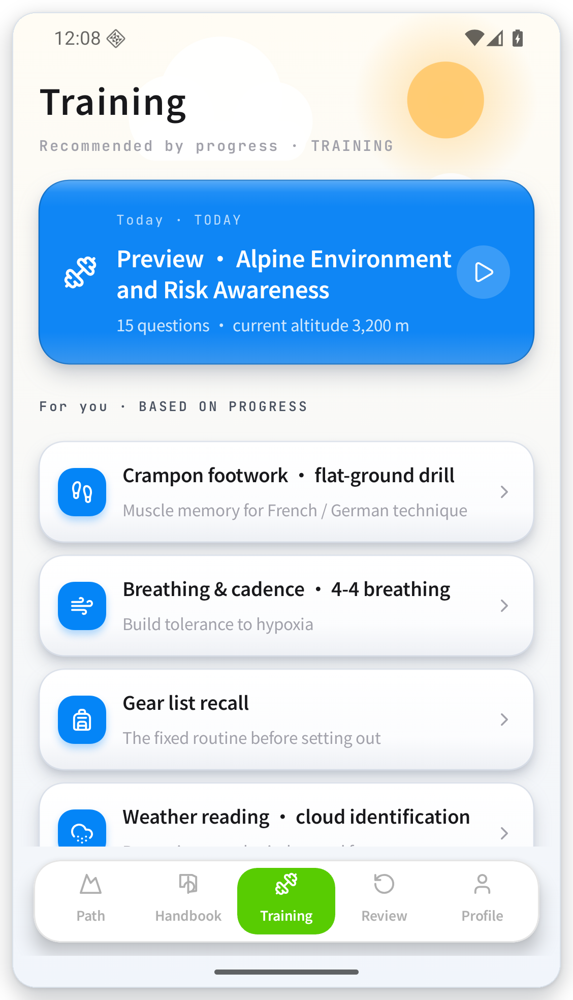
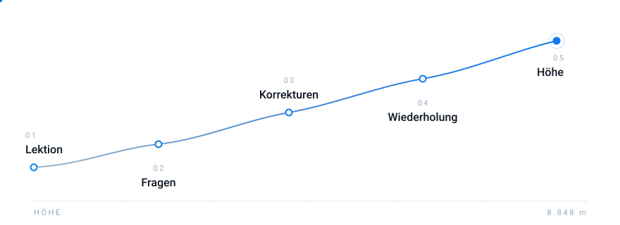
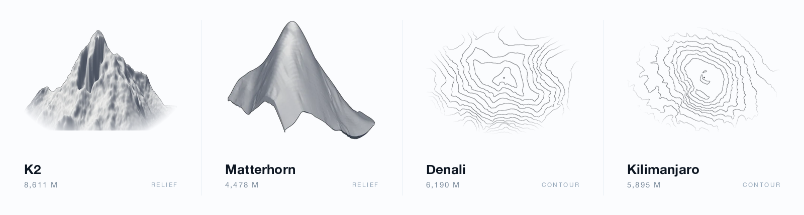
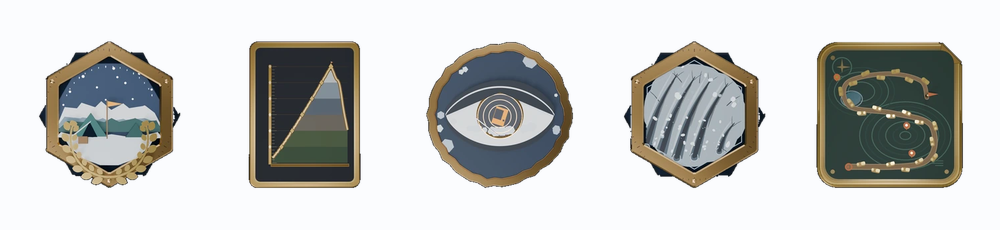

<p align="center">
  <picture>
    <source media="(prefers-color-scheme: dark)" srcset="assets/readme/hero-dark.png">
    
  </picture>
</p>

<br>

<p align="center">
  <a href="https://github.com/Solar-CV/AscentApp/releases"></a>&nbsp;
  <a href="https://ascentroam.com/support"></a>&nbsp;
  <a href="https://ascentroam.com"></a>
</p>

<br>

<p align="center"><sub>
<a href="README.md">English</a> · <a href="README.zh-CN.md">简体中文</a> · <a href="README.zh-TW.md">繁體中文</a> · <a href="README.ja.md">日本語</a> · <b><a href="README.de.md">Deutsch</a></b> · <a href="README.es.md">Español</a> · <a href="README.fr.md">Français</a> · <a href="README.it.md">Italiano</a> · <a href="README.ru.md">Русский</a> · <a href="README.sv.md">Svenska</a>
</sub></p>

Eine Android-App für Einsteiger in Hochtouren und Eisklettern. Der Lehrplan ist nach Höhe geordnet: mit jeder bestandenen Lektion geht es ein Stück höher.

<p align="center"><sub><b>Aktuelle Version v0.28.8 (versionCode 166) · Android 8.0+ · arm64-v8a · etwa 41 MB</b></sub></p>

<p align="center">
  &nbsp;
  &nbsp;
  &nbsp;
  &nbsp;
</p>

<p align="center"><sub>Pfad · Quiz · Handbuch · Training — englische Oberfläche, helles Design</sub></p>

<br>


## Der Aufstieg

Zwei Kurslinien lassen sich frei umschalten. **Hochtour** umfasst sechs Einheiten und 69 Lektionen, von der Einführung auf 5.000 m bis 8.000 m — durchgehend 3.200 m bis 8.848 m. **Trekking** umfasst vier Einheiten und 22 Lektionen, vom Tagesausflug bis zur Fernwanderung — 200 m bis 5.630 m. Jede Linie führt Fortschritt, Abzeichen und Wiederholungswarteschlange getrennt.

Der Startbildschirm ist eine Route vom Basislager nach oben, geteilt in Höheneinheiten (sechs beim Hochtouren, vier beim Trekking). Horizontal wischen blättert durch sie, zwei Einheiten pro Seite. Lektionen schalten linear frei — eine bestanden, die nächste offen. Knoten zeigen Sterne, die aktuelle Lektion trägt einen „Start"-Hinweis, die letzte Lektion einer Einheit ist gold markiert.

Jede Lektion läuft nach demselben Ablauf: lesen, Fragen beantworten, Fehler korrigieren, später wiederkommen.



Fortschritt ist keine gespeicherte Zahl. Er wird aus den abgeschlossenen Lektionen neu berechnet — wird die Höhenkurve später angepasst, rechnen sich alte Spielstände neu, statt hängenzubleiben.

## Echte Berge



Wer aufsteigt, schaltet unterwegs echte Schneegipfel frei: 88 Stück, vom Helan Shan auf 3.600 m bis zum Everest auf 8.848,86 m. Jeder trägt seine eigene Geländekarte, gezeichnet aus echten Höhendaten: ein schattiertes Relief, wo das Modell trägt, Höhenlinien, wo es nicht trägt. Die Karte zeigt die echte Höhe, das Gebirge und den Rang unter den Achttausendern.

Oben auf dem Pfad-Bildschirm zeigt die Karte stets den Berg, der zur aktuellen Höhe passt, und wie viele Meter noch fehlen. Unter „Profil → Aktuelle Höhe“ liegt der volle Atlas; freigeschaltete Gipfel öffnen ihre Karte, und jeder hat ein »Über diesen Berg«, geschrieben für das, was unterwegs wirklich zählt.

## Vierzig Abzeichen, echte Objekte



Abzeichen sind echte 3D-Objekte — Metallrahmen, Emaille-Einlagen, Relief. Ein entsperrtes Abzeichen im Profil oder an der Wand antippen und es öffnet sich im Vollbild: ziehen zum Drehen, mit zwei Fingern bis etwa 5,5× zoomen, mit zwei Fingern über das Relief schieben, Doppeltipp setzt zurück, und beim Loslassen wiegt es sich leicht. Die Icons stammen aus den Modellen selbst, Wand und 3D-Ansicht zeigen also dasselbe Objekt. Alle vierzig haben jetzt ein Modell; der Rückfall auf die stehende Grafik bleibt für Abzeichen, die später dazukommen. Wird ein Erfolg irgendwo freigeschaltet, zeigt der Dialog dasselbe 3D-Abzeichen, auf einem hellen Sockel, während von beiden Bildschirmrändern Bänder hereinfliegen.

## Was drin ist

**Fragenpool.** 1.563 reguläre Fragen plus 158 automatisch eingefügte Wiederholungskopien, zusammen 1.721 Anzeigeposten. Die Menge steigt mit der Höhe: rund 15 Fragen pro Lektion in der Einführung auf 5.000 m, 30 in den technischen Einheiten auf 7.000 m, 8 im Trekking.

Acht Fragetypen: Einfachwahl, Mehrfachwahl, Reihenfolge, Zuordnung, Lückentext, Rechnung, Hotspot (einen Punkt im Bild antippen) und Szenario (ein Stamm, in mehreren Schritten beantwortet).

Nach einer Lektion geht es direkt in die Wiederholung der falsch beantworteten Fragen. Richtig beantwortete bringen Punkte, der Rest wandert ins Wiederholungszentrum. Die Wiederholung arbeitet mit verteilten Intervallen von 0, 1, 3, 7, 16 und 35 Tagen. Sicherheitskritische Fragen sind gewichtet und verlangen eine Bestätigung des Verständnisses, bevor es weitergeht.

**Handbuch.** 35 lange Artikel mit je 4 bis 8 Abschnitten, sortiert nach Ausrüstung, Technik, Medizin, Gesundheit, Wetter, Meteorologie, Entscheidung, Beurteilung, Sicherheit, Risiko und Lawinenrettung. Das Handbuch ist nach Linie gefiltert: Schnee-und-Eis-Stücke erscheinen nur beim Hochtouren, Höhenmedizin, Unterkühlung, Navigation, Lager und Führung teilen beide Linien. Quellen sind öffentliches medizinisches und technisches Material, drei kommerzielle Führer-Dokumente und bearbeitete Transkripte von sieben chinesischen Bergbüchern. Laut Produktvereinbarung werden die chinesischen Bücher nicht mit Titel zitiert, die Führer-Dokumente schon.

**Training, Wiederholung, Profil.** Das Training empfiehlt die nächste Lektion und bietet vier Übungen: einen fünfminütigen 4-4-Atemtakt, vier 30-Sekunden-Sätze Steigeisen-Schrittrhythmus, ein Ausrüstungsquiz und ein Wolkenquiz. Die beiden Quizze ziehen Einfachauswahlfragen aus vorhandenen Lektionen, mischen die Antworten jede Runde neu und zeigen die Erklärung sofort nach jeder Antwort. Die Wiederholung stellt die heute fälligen Fragen und sicherheitskritische Fehler nach vorn. Das Profil enthält Kopfbereich, aktuelle Höhe, Fähigkeitsübersicht, Abzeichen-Einstieg, Kontobereich und einen Feedback-Einstieg. Das Zahnrad öffnet die Einstellungen, der Avatar die Profilseite.

**Einstellungen.** Das Erscheinungsbild folgt dem System oder lässt sich auf Hell oder Dunkel festlegen, wird gespeichert, die Statusleiste zieht mit. Die Sprache folgt dem System oder wird manuell gesetzt; Oberfläche und Inhalte wechseln gemeinsam, kein Neustart. Der Pool-Bereich zeigt die aktuelle Version, prüft auf Updates und stellt den mitgelieferten Pool wieder her. Der Entwicklermodus liegt hinter der Versionsnummer unter „Über" — siebenmal tippen. Unter „Über“ stehen Datenschutzerklärung, Nutzungsbedingungen (beide offline lesbar), App bewerten und Teilen-Link kopieren; Unterstützen ist ein einziger Eintrag, der die Unterstützungsseite im Browser öffnet.

**Feedback.** Profil → Feedback und Vorschläge, zwischen Kontokarte und Sicherheitshinweis. Art wählen — Fehler, Idee, Inhaltskorrektur —, Nachricht schreiben, optional eine Adresse für die Antwort hinterlassen und optional Diagnose dazulegen. Das Senden geht über Formspree direkt an den Maintainer; ohne Netz bietet der Bildschirm an, denselben Text per E-Mail zu schicken, und kopiert ihn in die Zwischenablage, wenn keine Mail-App vorhanden ist.

Die Diagnose ist standardmäßig aus und umfasst App-Version, Android-Version, Gerätemodell, Sprache, Pool-Version, aktuelle Linie, Fortschrittszahlen und die letzte unbehandelte Ausnahme. Kein Lektionstext, kein Antwortverlauf, kein Konto, keine Zwischenablage.

## Zehn Sprachen

Oberflächentexte und Kursinhalte gibt es in:

简体中文 (Quelle), 繁體中文, English, 日本語, Deutsch, Français, Español, Italiano, Русский, Svenska

Alle zehn Sprachen sind vollständig. Jede hat ihre eigene Einstiegsebene, Lektionskerntexte, Handbuchtexte und einen Fragenpool, und jeder Schlüsselsatz stimmt Eintrag für Eintrag mit dem Englischen überein — **10.727 / 10.727**, nichts fehlt, nichts doppelt, keine verwaisten Schlüssel.

| Ebene | Einträge | Alle 9 übersetzten Sprachen |
|---|---|---|
| Einstieg (Lektionen, Einheiten, Handbuchtitel, Gipfel) | 296 | 100 % |
| Lektionskerntexte | 451 | 100 % |
| Handbuchtexte | 378 | 100 % |
| Fragenpool (Stamm, Optionen, Erklärung) | 9.602 | 100 % |

Die Terminologie folgt dem Sprachgebrauch der jeweiligen Bergsteigerszene statt wörtlicher Übersetzung: schwedisch stegjärn / isyxa / standplats, deutsch Steigeisen / Pickel, russisch кошки / ледоруб, italienisch corda fissa / bloccante / sosta. Medizinische Dosierungen, Lawinenstufen, Hangneigungen und Temperaturen bleiben unverändert — angepasst wird nur das Zahlenformat, und die drei Konventionen bleiben bewusst getrennt:

- Englisch, Chinesisch, Japanisch: `6.5 °C`, `5,000 m`
- Deutsch, Spanisch, Italienisch: `6,5 °C`, `1.000 m` (Dezimalkomma, Tausenderpunkt)
- Französisch, Schwedisch: `6,5 °C`, `5 000 m` (Dezimalkomma, Tausenderleerzeichen)

Auch die Ansprache unterscheidet sich: Deutsch nutzt die unpersönliche man-Form, Spanisch duzt mit *tú*, Französisch siezt mit *vous*, Schwedisch und Italienisch duzen mit *du* / *tu* — die Lektionskerntexte bleiben in allen Sprachen unpersönlich.

Fehlt ein Eintrag in der gewählten Sprache, lautet die Reihenfolge: gewählte Sprache → Englisch → chinesische Quelle. Dieser Pfad ist inzwischen nur noch ein Sicherheitsnetz.

## Lehrplan

**Hochtour**

| Einheit | Höhe | Lektionen | Fragen | Pro Lektion |
|---|---|---|---|---|
| 5000M · Einführung | 5.000 m | 16 | 249 | 16 |
| 5000M · Aufbau | 5.300 m | 12 | 221 | 18 |
| 6000M | 6.000 m | 15 | 336 | 22 |
| 7000M · C3 Techniklager | 7.000 m | 6 | 185 | 31 |
| 7000M · C4 Hochlager | 7.500 m | 10 | 279 | 28 |
| 8000M | 8.000 m | 10 | 248 | 24 |

**Trekking**

| Einheit | Höhe | Lektionen | Fragen | Pro Lektion |
|---|---|---|---|---|
| Tageswanderungen | 1.200 m | 5 | 40 | 8 |
| Mehrtagestouren und Lager | 2.500 m | 9 | 93 | 10 |
| Höhentrekking | 3.800 m | 5 | 44 | 8 |
| Fernwege und Notfälle | 4.500 m | 3 | 26 | 8 |

Insgesamt 38 Zielgipfel und Routen: 30 fürs Hochtouren, von der Aotaina auf 5.211 m bis zu den vierzehn Achttausendern; 8 fürs Trekking, vom Huihang-Pfad bis zur Three-Passes-Route am Everest.

## Installation

Am einfachsten über das fertige APK aus den [Releases](https://github.com/Solar-CV/AscentApp/releases). Ein `v*`-Tag lässt GitHub Actions bauen und das APK anhängen.

- Paket: `com.ascentroam.app` (der Quellcode-Paketname bleibt `com.ascent.climb`)
- Minimum: Android 8.0 (API 26), **nur arm64-v8a** — reine 32-Bit-Geräte können diese Version nicht installieren
- Größe: etwa 41 MB (Abzeichenmodelle 38 MB unkomprimiert, rund 9 MB nach dem Paketieren; der Rest sind Fragenpool, Geländekarten und native Bibliotheken)
- Signatur: seit v0.21.2 mit Release-Zertifikat signiert. Über einen älteren Debug-Build lässt es sich nicht installieren – erst deinstallieren, dabei werden Fortschritt, Abzeichen und Einstellungen gelöscht
- Berechtigungen: Netzwerk und Netzwerkstatus — für die Prüfung auf Fragenpool-Updates und für Feedback. Alles funktioniert offline, der mitgelieferte Pool ist immer da

APK aufs Telefon übertragen, Installation aus unbekannten Quellen erlauben, tippen. Beim ersten Start ist keine Anmeldung nötig.

## Architektur



Jede Schicht spricht nur mit der darunterliegenden. Die Oberfläche liest Inhalte nie direkt; das Lernmodell rechnet aus den Inhalten neu; die Plattformschicht entscheidet, ob es einen neueren Fragenpool gibt, und hält sich sonst heraus.

- **Offline zuerst.** Der mitgelieferte Pool liegt in der APK; die Online-Kopie ersetzt den Cache nur, wenn sie neuer ist
- **Inhalte sind Daten.** Lektionen, Fragen, Handbuchtexte und Übersetzungen liegen in `data/`, nicht in der Oberfläche: eine Einheit dazu heißt Dateneinträge plus eine Zeile in `Curriculum.kt`
- **Zwei optionale Dienste.** Pool-Updates und Konto-Sync können beide fehlen; nichts anderes hängt an ihnen

<details>
<summary><b>Projektaufbau</b></summary>

```
AscentApp/
├── import/                      Fragenerstellung (Markdown, aus gedruckten Büchern)
├── knowledge/                   Wissensbasis der Druckquellen
├── tools/
│   ├── contentcheck/            Inhaltsprüfungen + Pool-Export (reines JVM)
│   ├── i18ncheck.py             Abdeckung pro Sprache über alle vier Ebenen
│   ├── qbank/build.mjs          Markdown → Fragenpool-Compiler
│   └── poc3d/                   Modellabgleich, Icon-Freistellung, Emissive-Backen
└── app/src/main/
    ├── res/values*/             Oberflächentexte für 10 Sprachen
    ├── assets/
    │   ├── badges/*.glb         40 Abzeichenmodelle
    │   └── env/studio_ibl.ktx   Prozedural erzeugte IBL-Umgebung
    └── java/com/ascent/climb/
        ├── data/
        │   ├── Unit1~5.kt      Inhalte der Hauptlektionen
        │   ├── NewLessons.kt    Spätere Lehrplanlektionen
        │   ├── i18n/Pack*.kt    Inhaltsübersetzungen (Einstieg / Kern / Handbuch / Pool)
        │   ├── Diagnostics.kt   Absturzprotokoll + Umgebungsaufnahme fürs Feedback
        │   ├── FeedbackSender.kt  Formspree-POST (HttpURLConnection, keine Extras)
        │   ├── BundledBank.kt   Zusammenbau des Lektionspools und Einfügen der Wiederholungen
        │   └── bank/            Pool-Konfiguration, JSON-Dekodierung, Netzwerk, Repository
        └── ui/                  Bildschirme und Bausteine (Badge3D.kt = Filament-Szene, Bildausschnitt, Licht)
```

</details>

## Selbst bauen

Die ganze Toolchain kann im Home-Verzeichnis liegen — kein Homebrew, kein Android Studio. Was diese Maschine nutzt:

- `~/android-toolchain/jdk`: Temurin OpenJDK 17
- `~/android-toolchain/sdk`: Android SDK mit platforms;android-36, build-tools;36.1.0, platform-tools
- `~/android-toolchain/gradle-8.11.1`: Gradle 8.11.1

```bash
export JAVA_HOME="$HOME/android-toolchain/jdk/Contents/Home"
export PATH="$JAVA_HOME/bin:$PATH"
export ANDROID_HOME="$HOME/android-toolchain/sdk"

cd AscentApp
"$HOME/android-toolchain/gradle-8.11.1/bin/gradle" assembleDebug
```

Das Repository bringt außerdem den Gradle-8.9-Wrapper mit, ein Rechner ohne Gradle funktioniert also auch:

```bash
cd AscentApp
./gradlew assembleDebug
```

Das Ergebnis liegt in `app/build/outputs/apk/debug/app-debug.apk`.

Für Google Play das App Bundle bauen: `./gradlew bundleRelease` → `app/build/outputs/bundle/release/app-release.aab`. Ein AAB lässt sich nicht direkt auf ein Telefon installieren; zum Sideloading dient weiterhin das APK.

### Inhalte ändern

Für neue Fragen in einer bestehenden Lektion `data/Expansion*.kt` bearbeiten. Für eine neue Lektion `Lesson(...)` in `data/NewLessons.kt` schreiben und die id in der passenden Einheit in `Curriculum.kt` ergänzen. Reihenfolge und Einheitenzugehörigkeit liegen nur in `Curriculum.kt`.

Danach die Prüfungen laufen lassen:

```bash
bash tools/contentcheck/run.sh
python3 tools/i18ncheck.py
```

Das erste Skript synchronisiert die Inhalte der App in ein reines JVM-Projekt, führt die echte Zusammenbaulogik aus und prüft Fragenanzahl, Schwierigkeitsverlauf, Antworten außerhalb des Bereichs, leere Fragen, Freischaltlogik und Erfolgsdefinitionen; anschließend exportiert es `bank/bank.json` und `bank/manifest.json`. Das zweite meldet die Abdeckung je Sprache über die vier Ebenen und vergleicht die Schlüssel. Beide brauchen keinen Emulator.

Nach Änderungen am Pool `BUNDLED_VERSION` in `data/bank/BankConfig.kt` erhöhen, sonst glaubt der Client, es habe sich nichts geändert.

## Online-Updates des Pools

Der Pool hat drei Ebenen: lokaler Cache, mitgelieferte Fassung, Online-Delta. Die Reihenfolge ist Cache → mitgeliefert; die Online-Fassung überschreibt den Cache nur, wenn sie neuer ist.

Im Flugzeug, im Tal ohne Signal, bei totem Server, fehlerhaftem JSON, falscher sha256 oder einer älteren Version bleibt also alles, wie es ist. Updates werden nach dem Start still geprüft, höchstens alle sechs Stunden und nur wenn eine URL konfiguriert ist.

Neuen Pool veröffentlichen: Inhalte ändern → `BUNDLED_VERSION` erhöhen → `contentcheck` laufen lassen → `bank/bank.json` und `bank/manifest.json` auf einen Server oder CDN legen → die App übernimmt ihn beim nächsten Start, ohne Release.

Ältere App-Versionen gehen an einem neueren Pool nicht kaputt. `minAppVersion` in `manifest.json` blockt zu alte Clients, unbekannte Felder werden ignoriert, eine fehlerhafte Frage wird übersprungen statt tödlich zu sein.

## Woher die Inhalte kommen

Zwei Hauptströme speisen Fragen und Handbuch.

Zu den öffentlichen Quellen gehören die 2024er Aktualisierung der klinischen Leitlinien für akute Höhenkrankheit der Wilderness Medical Society, das CDC Yellow Book, technisches Material des American Alpine Institute und des American Alpine Club, REI Expert Advice, die Ausrüstungsnormen von UIAA und CE sowie Lawinendaten von avalanche.org.

Die drei Führer-Dokumente von SEVEN SUMMIT TREKS — Höhenkrankheit, Ausrüstung, allgemeine Expeditionspraxis — sind der zweite Strom.

Später wurden geprüfte Transkripte von sieben chinesischen Bergbüchern zu Handbuchtexten verarbeitet. Wissen und Fälle sind in eigenen Worten wiedergegeben, mit Seitenangaben; der gescannte Quelltext liegt nicht im Repository.

| Quelle | Verwendet für |
|---|---|
| WMS / CDC / StatPearls | Höhenmedizinische Fragen und Handbuch |
| AAI / AAC / REI / BMC | Schnee-, Eis- und Bewegungstechnik |
| UIAA / CE-Normen | Ausrüstungsfragen |
| avalanche.org | Lawinenbeurteilung |
| SEVEN SUMMIT TREKS | Handbuch h17–h22 und zugehörige Fragen |
| 7 chinesische Bergbücher | Handbuch h23–h31 |

## Sicherheitsgrenze

Die App deckt nur Theorie und kognitive Vorbereitung ab. Praktische Fertigkeiten — Schnee und Eis, Seiltechnik, Eisklettern, Rettung — müssen von einer zertifizierten Ausbilderin oder einem zertifizierten Ausbilder vor Ort vermittelt und geprüft werden.

Nichts hier ist medizinischer Rat. Entscheidungen zu Medikamenten und Erster Hilfe gehören in ärztliche Hand.

Kein Gipfel wird versprochen, kein Akklimatisierungserfolg garantiert.

Lektionen, die eine Begleitung erfordern, sagen das ausdrücklich, sobald die Theorie durch ist.

## Letzte Änderungen

<details>
<summary><b>Versionsnotizen, v0.28.8 zurück bis v0.13</b></summary>

**v0.28.8: Einstellungen vervollständigt, Geländekarten für Wanderungen, zwei Korrekturen**

- Die Einstellungen haben, was fehlte: Nutzungsbedingungen (offline lesbar), App bewerten, Teilen-Link kopieren und ein Eintrag »AscentRoam unterstützen«, der die Unterstützungsseite im Browser öffnet — in der App selbst taucht keine Zahlungsplattform auf

- Die Tastatur schiebt die untere Tableiste nicht mehr hoch, und die Wettersonne oben rechts sitzt mittig über der Serie, statt das Seil-Symbol zu überdecken

- Wanderrouten haben jetzt Geländekarten: 39 von 44 zeigen Grate, Täler und Küstenlinien und den Verlauf der Route, anstelle des Höhenprofils. Lange Wege liegen auf einer weichen Schattierung; mehrere hundert Kilometer wie der Jakobsweg oder der JMT werden als Schema mit Verlauf und wichtigen Orten gezeichnet

- Alle 88 Gipfel haben ein »Über diesen Berg«, alle 44 Routen ein »Über diese Route«, in neun Sprachen; der Wanderatlas stellt deine Region nach der Oberflächensprache nach vorn

**v0.27.1 – v0.27.2: Die Oberfläche folgt dem Wetter**

- Der Hintergrund spiegelt jetzt den Himmel: klar, bedeckt, Regen, Gewitter oder Schnee. Klar und bedeckt sind still, Regen / Gewitter / Schnee bewegen sich; nachts wird aus der Sonne ein Mond und die Palette wechselt ins Dunkle
- Einstellungen → Darstellung hat einen Schalter „Wetterhintergrund": an folgt er dem Wetter vor Ort (eine einmalige grobe Standortabfrage), aus bleibt der Himmel klar. Standard ist aus, und ohne ihn ändert sich nichts
- Wetterdaten kommen von Open-Meteo und werden drei Stunden lang auf dem Gerät zwischengespeichert; die Datenschutzerklärung beschreibt das jetzt an zwei Stellen
- Alle Rundungen sind als Squircle neu gezeichnet: Chips, Karten, Tab-Leiste. Größen und Farben unverändert — die Ecke „stockt" an der Naht zur geraden Kante nicht mehr

**v0.27.0: Anmeldung mit Google**

- Der Anmeldebildschirm hat jetzt „Mit Google fortfahren": Credential Manager liefert ein ID-Token, der Server prüft es, und beim ersten Mal wird das Konto angelegt
- Beim ersten Anmelden kommen Name und Profilbild von Google mit — das Bild wird geladen, quadratisch zugeschnitten und über denselben Weg wie ein manuell gewählter Avatar hochgeladen
- Google ist eine Abkürzung, keine Voraussetzung: Registrierung, Anmeldung und Passwort-Reset per E-Mail bleiben unverändert, und die App funktioniert weiterhin vollständig offline ohne Konto
- Ohne Google Play-Dienste oder bei abgebrochener Kontoauswahl erscheint ein klarer Satz statt eines nichtssagenden „Anmeldung fehlgeschlagen"

**v0.26.9: Die deutsche Tab-Leiste schneidet nichts mehr ab**

- Der Wiederholen-Tab nutzte den Seitentitel („Wiederholung", 12 Zeichen) — breiter als ein Tab-Platz, sodass der letzte Buchstabe aus dem abgerundeten Hintergrund fiel. Der Tab hat jetzt eine eigene kurze Beschriftung: „Üben"

**v0.26.7 – v0.26.8: Die Erklärung holt auf, die Daten bekommen einen Besitzer**

- Die Datenschutzerklärung beschreibt jetzt das Feedback in der App: gesendet werden dein Text, eine E-Mail-Adresse, falls du eine angibst, und — **nur wenn du das Häkchen setzt** — Diagnosedaten (App-Version, Android-Version, Gerätemodell, Oberflächensprache, letzter Absturzbericht). Fassung 2026-11-05, keine erneute Zustimmung nötig
- Avatare gehören zum Konto: Beim Abmelden verschwindet das Bild sofort, und ein anderes Konto zeigt sein eigenes (ohne eigenes Bild einen Buchstaben-Platzhalter), nie das vorherige
- Ein stiller Fehler ist behoben: Nach Löschen und erneutem Hochladen begann die Cloud-Revision wieder bei 1, sodass andere Geräte den neuen Avatar nie erhielten
- Auch der Fortschritt kennt seinen Besitzer: Abmelden behält den lokalen Fortschritt, Offline-Lernen bleibt möglich; dasselbe Konto wird wie bisher zusammengeführt, ein anderes Konto ersetzt die lokalen Daten durch seine Cloud-Daten, statt den alten Fortschritt mitzunehmen

**v0.26.6: Datenschutz vor der Registrierung**

- Für ein Konto muss jetzt der Datenschutzerklärung zugestimmt werden. Der vollständige Text (10 Abschnitte) liegt in der App und ist offline lesbar — kein WebView; auf vereinfachtem und traditionellem Chinesisch sowie Englisch, andere Sprachen fallen auf Englisch zurück
- Jederzeit unter Einstellungen → Über → Datenschutzerklärung nachlesbar; bei Anmeldung und Passwort-Reset wird nicht erneut gefragt

**v0.26.4 – v0.26.5: angemeldete Geräte und ein Splash, der zum Icon passt**

- Einstellungen → Konto hat jetzt **Angemeldete Geräte**: Plattform, Version und letzte Nutzung pro Sitzung, einzeln widerrufbar. Auch das aktuelle Gerät lässt sich widerrufen — der Dialog erklärt, dass man abgemeldet wird und der Fortschritt bleibt
- Die Flagge auf dem Gipfel im Splash war ein hohes, schmales Dreieck: Der Pfad hatte einen Skalierungsfaktor auf x, aber nicht auf y. Korrigiert, jetzt Punkt für Punkt wie das Launcher-Icon; das alte `ic_splash_mark` wurde auf demselben Raster neu gezeichnet
- Lange Untertitel ziehen Zeilen in den Einstellungen nicht mehr in die Höhe — Titel und Untertitel sind auf eine Zeile begrenzt, sieben Sprachen haben kürzere Texte bekommen (im Italienischen wurde zuvor die Versionsnummer selbst abgeschnitten)
- Der Abzeichen-Eintrag ist aus dem „Profil"-Tab entfernt; Abzeichen gibt es auf der Profil-Startseite

**v0.25.0 – v0.26.3: Konten in der Cloud und ein neuer Name**

- Konten sind jetzt echt: Registrierung und Anmeldung per E-Mail gegen ein gehostetes Backend, Sync von Fortschritt und Avatar, „auf einem anderen Gerät anmelden und alles ist wieder da". Weiterhin optional — die App funktioniert ohne Konto und offline vollständig
- Lokales Profil: Avatar über eine 1:1-Zuschnittseite wählen (Zoomen, Verschieben, Drehen), Anzeigename änderbar; die EXIF-Ausrichtung wird beachtet, Hochformatfotos liegen nicht mehr quer
- Konto löschen unter Einstellungen → Konto, mit einem Bestätigungsdialog: was gelöscht wird (Serverdatensatz, Fortschritt, Abzeichen, Avatar, Name) und was bleibt (Design, Sprache, Track)
- „Lernfortschritt zurücksetzen" liegt jetzt in den Einstellungen und fragt nach; Name, Avatar und Sprache werden nicht mehr mitgelöscht
- Umbenannt von ASCENT zu **AscentRoam** (ascentroam.com); die Package-ID ist jetzt `com.ascentroam.app` — läuft neben der alten Version, ist auf dem Gerät aber eine eigene App
**v0.24.0: bereit für Google Play**

- Jedes Release hat jetzt zwei Anhänge: das APK zum Sideloaden und `ascent-<tag>-release.aab` für Google Play
- 16 KB-Speicherseiten: geprüft, keine Änderung nötig. Alle vier nativen Bibliotheken (Filament, gltfio, filament-utils, androidx.graphics.path) richten jedes `PT_LOAD`-Segment auf 0x4000 aus, und das APK speichert sie unkomprimiert und 16 KB ausgerichtet
- `targetSdk` 34 → 36, `compileSdk` ebenso; AGP 8.5.2 → 8.9.2, Gradle 8.9 → 8.11.1. Ab API 35 erzwingt das System edge-to-edge, deshalb ruft die App jetzt `enableEdgeToEdge()` auf und reserviert im Wurzel-Layout `safeDrawing`-Abstände, statt sich auf die alten Statusleisten-Farben zu verlassen
- `tools/check_16k.py` plus eine CI-Prüfung: ein Build, der eine der Prüfungen nicht besteht oder unter 35 zielt, wird nicht mehr veröffentlicht
- Die 3D-Badge-Ansicht zeigt fps-, Backend- und Bloom-Infos nur im Entwicklermodus — normale Nutzer sehen diese Zeile nicht mehr
- Das Zurücksetzen einzelner Erfolge im Testbereich fragt jetzt nach (nach 4 s automatisch zurück), ein Fehltipp löscht kein Abzeichen mehr
- Der Debug-Build hat eine eigene Package-ID (`com.ascent.climb.debug`) und lässt sich neben der Release-Version installieren

**v0.23.3: die Wolkenlektion wächst**

- Klettern 6 → 18 Fragen, Trekking 5 → 12, jede Frage mit einem anderen Foto; die Bildsammlung wuchs von 7 auf 31 (NOAA NESDIS plus öffentliche NWS-Wolkenbilder)
- Cirrocumulus, Altostratus, Stratocumulus, Cumulus congestus, Fallstreak Holes, Fractus, Shelf Clouds, Wall Clouds, Tal-Radiationnebel und Kondensstreifen sind dabei; jede Wolkenart hat zwei oder drei Fotos und fragt erst erkennen, dann Entwicklung, dann was zu tun ist
- Der Wetter-Übungspool wuchs von 63 auf 68. Nach dem Antworten bleibt die Ansicht am Kopf der Erklärung stehen, damit ein hohes Foto nicht aus dem Bild geschoben wird

**v0.23.0 – v0.23.2: Ersteinrichtung und Wolkenlektion**

- Beim ersten Start werden nur zwei Dinge gefragt: Klettern oder Trekking und die Sprache — live angezeigt, gespeichert beim Tippen auf Weiter
- Hochformat gesperrt; der Entwickler-Schalter „Antwort anzeigen" gilt jetzt auch für die Übungen
- Zwei Lektionen zum Wolkenlesen; die Übungsansicht zeigt Fragebilder und öffnet sie im Vollbild

**v0.22.0: Das Training trainiert jetzt wirklich**

- Zwei Übungen sind aktiv: ein fünfminütiger 4-4-Atemtakt (8-Sekunden-Zyklus, Kosinus-Easing) und vier 30-Sekunden-Sätze Steigeisen-Schrittrhythmus (ein Schritt alle 1,2 s, abwechselnd links/rechts)
- Beide erfassen die **tatsächliche** Dauer: ein vorzeitiges Beenden speichert die geübte Zeit, nicht die volle Länge; unter 15 Sekunden wird nichts gespeichert
- Ausrüstungs- und Wetterübungen sind als „bald verfügbar" markiert statt als tote Zeilen

**v0.21.2: Release-signierte Builds** — das APK in den Releases ist jetzt release-signiert und R8-minifiziert: 30 MB statt 41 MB. Auf Geräten mit älterem Debug-Build muss zuerst deinstalliert werden, dabei werden lokale Daten gelöscht.

**v0.21.1: drei Korrekturen**

- Das Handbuch war in allen Sprachen außer den beiden chinesischen leer. Der Filter „Alle" speicherte seine übersetzte Beschriftung als Filterwert; nach einem Sprachwechsel passte sie weder zum neuen „Alle" noch zu einer Kategorie, und alle 35 Artikel wurden ausgefiltert
- In Französisch und Spanisch wurden die Beschriftungen der unteren Leiste auf schmalen Bildschirmen abgeschnitten: die Auswahl war fast ein Kreis, ein Wort mit 13 Zeichen lief darüber hinaus. Jetzt ein abgerundetes Rechteck, die Schriftgröße richtet sich nach der breitesten Beschriftung
- Der Radius des äußeren Rahmens schneidet das erste und letzte ausgewählte Element nicht mehr an – er bleibt innerhalb von Innenabstand plus Radius des Indikators

**v0.20.19 – v0.21.0: Ton-Oberflächen**

- Karten sind jetzt Ton: vier Lagen pro Karte — Außenschatten, Kantenlicht, ein kurzes Highlight oben und eine innere Abdunklung. Der Schatten entsteht per `BlurMaskFilter` offscreen und wird nach Größe und Radius zwischengespeichert. `Modifier.blur()` braucht API 31, das Projekt läuft ab 26; `Modifier.shadow()` kann keinen farbigen zweilagigen Schatten
- Fünf Bildschirme neu gestaltet: Profil, Wiederholung, Training und Handbuch, danach die Seite „Mein". Das Highlight wurde auf eine 20-dp-Lippe zurückgenommen, die Kontur von 1 physischen Pixel auf dp umgestellt und der Schatten in Volumen- plus Kontaktschatten geteilt — vorher wirkten die Karten halbtransparent, weil das Highlight ihre Kanten ausgewaschen hat
- Handbuchkategorien tragen eigene Farben (Ausrüstung stahlblau, Seile türkis, Schnee und Eis indigoblau, Medizin rot, Beurteilung amber, Planung grün, Führung magenta); die Chips sind flächig gefüllt, ohne Verlauf, und das Titelbild der Detailseite übernimmt die Kategoriefarbe
- Mehrere gleichzeitig freigeschaltete Erfolge überlagern sich nicht mehr: die 3D-Ansicht wird pro Erfolgs-id neu aufgebaut, und der Hintergrund bleibt zwischen den Dialogen deckend

**v0.20.18: neu exportiertes Everest-Diorama**

- Das Modell für „Climbing Grand Slam" wurde rund um die Details neu gebaut: Gebetsfahnen sind jetzt 0,42 × 0,26 mm groß (vorher auf dem Handy unsichtbar), ihre Schnüre liegen auf doppelten Steinhaufen und jede Fahne wird gegen den Schnee geprüft, kleine Teile tasten direkt das Terrain-Mesh ab statt die ganze Szene per Raycast
- Das Icon stammt aus dem neuen Hero-Render; Pose und Bildausschnitt sind unverändert

**v0.20.17: kein versehentliches Wegdrehen mehr**

- Wurde nach einer Pinch-Geste ein Finger gehoben, galt das als Ein-Finger-Ziehen — mit einem Bezugspunkt eine Handbreit entfernt: das Abzeichen sprang und nahm den Sprung in den Schwung mit. Die Geste ist jetzt eine Zustandsmaschine: nach Beginn einer Zwei-Finger-Geste wird der verbleibende Finger ignoriert, und ein Pinch hinterlässt keinen Schwung
- Beim Herangezoomtsein schwingt nichts mehr automatisch, und die Rückkehr zur Vorderseite ist ein weiches Drehen statt eines Sprungs

**v0.20.16: Details heranzoomen**

- Die Pinch-Geste kam bisher auf höchstens 1,25-fache Vergrößerung — Gipfelnamen und Höhenangaben blieben auf dem Handy unlesbar. Jetzt geht es bis 5,5-fach
- Mit zwei Fingern im gleichen Abstand schwenkst du die Ansicht und erreichst die Ecken; ein Finger dreht weiterhin. Doppeltipp setzt Zoom und Schwenkung zurück, unter dem Abzeichentitel steht nun ein kurzer Gestenhinweis

**v0.20.15: alle vierzig Abzeichen in 3D**

- Die letzten sechs sind da: Eight K Grad (Doktorhut), Final Exam (Gipfelmedaille mit Fahne), Five Zones (Laufsohlen-Platte), Fourteen Peaks (2,5:1-Panorama aller vierzehn Achttausender), Two Tracks (Zweischienen-Tablett) und Full Route (ein Everest-Geländemodell — das einzige Stück, das keine Medaille ist)
- Jedes Abzeichen-Icon ist jetzt der eigene Render des Modells; die handgezeichneten Ersatzbilder verschwinden von der Wand
- Full Route braucht eine eigene Pose: es steht auf seinem Sockel, also entfällt die 90°-Drehung der flachen Medaillen, und die Plakette wird zum Objektiv gedreht; sein Render liegt auf Grau statt Schwarz, entsprechend wird gegen Grau freigestellt
- Modelle 34 → 40; Paket 39,4 → 40,6 MB

**v0.20.14: Abzeichen überall öffnen**

- Abzeichen sind nicht mehr nur im Entwickler-Testbereich erreichbar: Tippe in „Mein Profil“ oder auf der Abzeichenwand ein freigeschaltetes Abzeichen an, und es öffnet sich im Vollbild. Die Ansicht liegt über der App, statt die Seite zu ersetzen — zurück geht es dorthin, wo du warst, inklusive Scrollposition, und die untere Leiste ist verdeckt
- „Trail Finish“ zeigte noch das geteilte Platzhalter-Icon, obwohl das Modell längst da war; die Zuordnung zeigt jetzt auf das gerenderte Icon
- „Two Tracks“ hatte das Foto einer Person als Icon — ein übrig gebliebener Platzhalter. Jetzt steht dort eine gezeichnete Platte (marineblaues Email, Messingrand, zwei gestrichelte Routen zum Gipfel), und das Foto ist aus dem Paket verschwunden

**v0.20.13: sechs weitere Abzeichenmodelle**

- Die Bibliothek wächst von 28 auf 34: 6.000 m Lernen, Comeback, Sieben-Tage- und Drei-Wochen-Spuren, zwanzig Läufe und ein D-förmiger Karabiner für „Sicherheit zuerst“; self_arrest neu exportiert
- Die Icon-Freistellung entfernt jetzt auch Hintergrund, der von der Abzeichenform *umschlossen* ist — das Mittelloch des Karabiners und die Lochung einer Stanzkarte waren bisher massiv schwarze Scheiben. Jede eingeschlossene Fläche wird einzeln geprüft: gleichmäßige Farbe wie der Hintergrund gilt als Loch, Verläufe bleiben. Paket 38.5 → 39.4 MB

**v0.20.11: Beleuchtung und Hintergrund der 3D-Badge-Ansicht**

- Die Badge-Ansicht hatte zwei Lichter, daher gab es nur einen einzigen Glanzbogen und das Relief blieb flach. Jetzt sind es fünf gerichtete Lichter — Key, Top, Front-Fill, Rim und ein schwacher Bounce von unten — bei unveränderter Gesamtbeleuchtung: mehr Tiefe, ohne auszubleichen
- Ein zweiter, dunklerer Hintergrund (ein Synthwave-Sonnenuntergang, stark verwischt zu reinen Farbflächen) passt zum dunklen Modus. Die Pille oben rechts schaltet zwischen hell und dunkel, folgt standardmäßig dem System und merkt sich die Wahl; nur dieser Bildschirm ist betroffen

**v0.20.8 – v0.20.10: Startbildschirm**

- Der Startbildschirm ist jetzt aus Clay: eine weiße Scheibe mit straffer, scharfkantiger Schattierung, das Gipfelzeichen und statt des alten Slogans ein zufälliges Zitat eines Bergsteigers — Mallory, Whymper, Muir, Boukreev, Viesturs, Tabei, Messner, Lowe oder Bonatti. Nach rund 1,7 s blendet er aus, bei reduzierter Bewegung wird er fast übersprungen. Sonst hat sich in der App nichts geändert Ab v0.20.9 zeigt der System-Splash kein Logo mehr — das Start-Theme ist nur noch die gleiche Hintergrundfarbe, sodass der Clay-Screen auf einem leeren weißen (oder fast schwarzen) Feld beginnt. Jedes Zitat steht in der Originalsprache

**v0.20.6 – v0.20.7: Darstellungsqualität der Abzeichen**

- Bloom läuft standardmäßig in höchster Qualität — 256 px, vier Stufen, MEDIUM. Die alte automatische Herabstufung urteilte schon ab dem ersten Frame, sodass wenige hundert Millisekunden Shader-Kompilierung den Bloom für die restliche Sitzung abschalteten. Jetzt wird 2,5 s gewartet, die Schwelle liegt bei 50 ms (20 fps) über drei aufeinanderfolgende Fenster, und die Stufen laufen voll → reduziert → aus
- 4x MSAA ist aktiv, wo der Treiber es unterstützt; die Fähigkeit wird vor dem Erzeugen der Swap Chain geprüft. Scheitert der Versuch, wird ohne MSAA weitergezeichnet und der Fehlschlag gemerkt — ein Antialiasing-Flag darf nie dazu führen, dass ein Abzeichen nicht erscheint

**v0.20.4 – v0.20.5: kleine Korrekturen**

- Der Entwicklermodus ist bis zur Freischaltung unsichtbar — der ganze Abschnitt in den Einstellungen, inklusive „Aus · Versionsnummer siebenmal tippen", erscheint für normale Nutzer nicht mehr. Der Zähler für die sieben Tipps funktioniert weiter, zählt aber nicht mehr laut mit
- Auch im Erfolgs-Testbereich bleibt die Scrollposition erhalten: in die 3D-Ansicht eines Abzeichens und zurück, und von den Einstellungen in den Testbereich und zurück
- Der Freischaltdialog schließt nicht mehr bei einem Streiftipp: der erste Tipp auf den Hintergrund spannt ihn nur vor und blendet „Erneut tippen zum Schließen" ein; der zweite schließt. „Annehmen" und die Zurück-Geste schließen weiterhin sofort

**v0.20.0 – v0.20.3: 3D-Abzeichen**

- 34 Erfolge werden in Echtzeit 3D gerendert (Filament 1.75, glTF, PBR-Metall und Emaille). Ziehen dreht, zwei Finger zoomen, in Ruhe wiegt sich das Objekt leicht; die automatische Bewegung bleibt an der Vorderseite, weil die Rückseite einer Medaille eine glatte Platte ist
- Seit v0.20.15 haben alle vierzig ein Modell; der Rückfall auf die gekippte Karte bleibt für künftige Abzeichen auf 3D
- Freischalt- und Vorschau-Dialoge laufen über denselben Renderer, mit hellem Sockel hinter dem Modell (ein dunkles Modell auf dunkler Karte verschwindet) und 56 Bändern aus beiden Richtungen. „Bewegung reduzieren" schaltet die Bänder ab
- Die Anzeigeseite sitzt auf einer stark unscharfen Landschaft, prozedural erzeugt (27 KB) — Himmel, vier Grate, Nebel, keine Fotolizenz nötig
- Ziehrichtungen nach Feedback umgedreht; die Szene insgesamt aufgehellt und dann leicht zurückgenommen, damit emittierende Teile Kontrast behalten
- In den Modellen angelegte Lichter überleben jetzt: `KHR_lights_punctual`-Entitäten werden ausdrücklich in die Szene gehängt (glTF-Asset-Entitäten enthalten sie nicht) und ihre Intensität wird an die Belichtung der Szene skaliert — 54 cd neben einem Schlüssellicht mit 66.000 Lux sind sonst unsichtbar. `KHR_materials_emissive_strength` wird beim Bauen in `emissiveFactor` gebacken, Bloom ist an und schaltet sich ab, wenn die Frame-Zeit über 28 ms bleibt
- Die Modellbibliothek wuchs in diesem Abschnitt von 17 auf 34: Serien, Perfekt, Wiederholung, Rückzug, Trekking-Abschluss und drei Neuausgaben kamen dazu; Paket 21 → 39 MB
- **Abzeichen-Icons kommen jetzt aus den Modellen**: vom Frontrender wird der schwarze Hintergrund zur transparenten 256-px-Grafik freigestellt, sodass Wand, Freischaltdialog und 3D-Ansicht dasselbe Objekt zeigen. Die KI-Illustrationen dieser Abzeichen wurden verworfen
- Spotlight-Verstärkung auf 5× vereinfacht (das eigene Spotlight des Modells zielt in den Medaillenkörper, aus keiner Verstärkung wird es von vorn sichtbar — das gehört in die Blender-Quelle), Bloom auf 0,05 gedreht
- v0.20.3: Die Scrollposition einer Liste überlebt den Ausflug in einen Unterschirm (Einstellungen → Sprache, Handbuch → Artikel, Profil → Einstellungen, Wiederholung → Lektion), und die Rückkehr aus einer Lektion setzt den Routen-Pager nicht mehr auf Seite eins

**v0.19.25 – v0.19.30: Arbeit an der App**

- Erfolge an den Pool mit 89 Lektionen angeglichen. `full_route` bedeutet jetzt alle 68 Hochtouren-Lektionen — vorher stand dort 66, und es wurde gegen die gerade offene Linie geprüft, sodass Trekking allein den „theoretischen Grand Slam" einbrachte. `five_zones` wurde zu „sechs Zonen" passend zu den sechs Hochtouren-Einheiten. Fünf Trekking-Erfolge ergänzt, 35 → **40**
- Der Erfolgsfortschritt wird über beide Linien gerechnet statt über die gewählte, das Ziel verschiebt sich beim Umschalten also nicht mehr
- Linien-Icons als massive Silhouetten neu gezeichnet — Schneegipfel und Bergstiefel — und damit die `▲` / `≡`-Zeichen im Sheet ersetzt; die oberen Pillen tragen dieselben zwei in 14 dp
- Splash-Logo um 40 % verkleinert
- Feedback-Bildschirm im Profil, der an Formspree sendet, mit E-Mail- und Zwischenablage-Rückweg; der Crash-Handler behält die letzten fünf unbehandelten Ausnahmen im app-privaten Speicher
- Profil und Startseite zählten den Gesamtfortschritt gegen die Lektionszahl der aktuellen Linie und zeigten nach dem Umschalten „68 / 21"; behoben

v0.19 ist die Inhaltserweiterung; Pool-Struktur und Bewertungslogik sind unverändert.

- Lektionen 47 → 89: Hochtouren jetzt 68 (Einheiten 6000 / 7000 / 8000 m, alle vierzehn Achttausender), dazu 21 neue Trekking-Lektionen
- Fragen 711 → 1.533 (9.422 Schlüssel), Handbuch 31 → 35 Artikel (Lawinenverschüttung und Reanimation, das Lawinen-Trio, Fixseile, Flussquerung), Pool v15 → v19
- **Neun Sprachen jetzt vollständig über alle vier Inhaltsebenen**: Englisch, Traditionelles Chinesisch, Japanisch, Russisch, Deutsch, Spanisch, Französisch, Schwedisch, Italienisch. Ihre Schlüsselsätze stimmen mit dem Englischen überein (10.554 / 10.554), zur Laufzeit fällt nichts zurück
- Deutsch nutzt die unpersönliche man-Form, Spanisch duzt mit tú, Französisch siezt mit vous, Schwedisch und Italienisch duzen mit du / tu; jede Sprache folgt ihren Zahlenkonventionen — Deutsch, Spanisch und Italienisch schreiben 1.000 m, Französisch und Schwedisch 5 000 m, alle mit Dezimalkomma
- Verwaiste Schlüssel aus früheren Inhaltsänderungen (`q.l2#5.c`, `m15#17.c`, `m16#18.c`, `m16#22.c`, `m16#24.c`) wurden aus allen neun Sprachen entfernt, sodass jeder Schlüsselsatz sauber und identisch ist
- Traditionelles Chinesisch läuft über OpenCC s2twp plus Terminologietabelle, per Regression gegen die bestehenden Übersetzungen geprüft (null Abweichungen); Japanisch ist eine echte Übersetzung, mit einem Register für den Fragenpool und einem für das Handbuch
- `tools/i18n/` bietet drei Kommandos (`status.py` / `prep.py` / `apply.py`) für alle neun Sprachen; für Traditionelles Chinesisch zusätzlich `tw.py` und `tw_entry.py`
- Der Pool ist auf Dateien verteilt: eine einzelne Kotlin-Datei mit rund 2.500 Einträgen bringt den Compiler zum Absturz, deshalb ist jede der neun Übersetzungssprachen in drei Teile geteilt (`Pack*Quiz.kt` / `Quiz2` / `Quiz3`)

v0.16 bis v0.18 waren reine Mehrsprachigkeitsarbeit; Pool-Struktur und Bewertungslogik blieben unverändert.

- Oberflächentexte in 10 `res/values*`-Sätze aufgeteilt; die Sprache lässt sich manuell setzen oder dem System folgen, wirksam sofort
- Neue Inhaltsebene `data/i18n/` mit vier Paketen pro Sprache: Einstieg, Kernpunkte, Handbuchtext, Fragenpool. 4.727 Einträge pro Sprache
- Alle vier Ebenen in den neun Übersetzungssprachen (zh-TW, en, ja, de, fr, es, it, ru, sv) fertig; die acht außer Englisch Schlüssel für Schlüssel gegen die englische Quelle geprüft, null fehlend
- Terminologie an den jeweiligen Sprachgebrauch angeglichen; Dosierungen, Lawinenstufen, Hangneigungen und Temperaturen unverändert übernommen
- `tools/i18ncheck.py` ergänzt, damit ein Kommando die Abdeckung über alle vier Ebenen zeigt — kein „übersetzt, aber eine Lektion fehlt" mehr
- Unterwegs eine Reihe von Textfehlern behoben: ein Komma-vor-Gedankenstrich-Fehler (140 im Schwedischen, je 5 im Deutschen und Spanischen), zwei Lückentextantworten mit überzähligem Anführungszeichen und drei französische Dezimalzahlen

Früher:

- v0.15.1: Textbereinigung in der App, wörtliche `**`-Marker entfernt, eine Reihe Erklärungen neu geschrieben, die Anmeldeseite verspricht keine nicht implementierte Synchronisierung mehr
- v0.15.0: neun weitere Handbuchartikel aus chinesischen Büchern (h23–h31), neue Kategorie „Führung im Gelände", 22 → 31 Artikel
- v0.14.0: sechs Führer-Artikel von SEVEN SUMMIT TREKS
- v0.13.x: Einstellungen, Profilseite, Abzeichenwand; Zurück-Geste auf Unterschirmen

</details>

## AscentRoam unterstützen

AscentRoam ist ein unabhängig entwickeltes, frei zugängliches Lernprojekt für draußen. Es gibt keine Werbung und keine bezahlten Freischaltungen. Wenn dir das Projekt gefällt und du möchtest, dass es weiterentwickelt und gepflegt wird, kannst du es freiwillig über Afdian unterstützen.

**Jede Unterstützung ist eine Spende ohne Gegenleistung**: Sie bringt keine zusätzlichen Funktionen, keine digitalen Inhalte, keine exklusiven Abzeichen und keine sonstigen Ansprüche. Alle Nutzer haben immer dieselbe App. Jeder Beitrag fließt in die Weiterentwicklung des Projekts.

- [Afdian](https://afdian.com/a/ascent)
- [Ko-fi](https://ko-fi.com/ascentroam)

Danke, dass du mitgehst.


## Lizenz

PolyForm Noncommercial License 1.0.0 — nur nichtkommerzielle Nutzung. Kommerzielle Nutzung braucht eine separate schriftliche Erlaubnis; siehe `LICENSE` und `NOTICE`.
