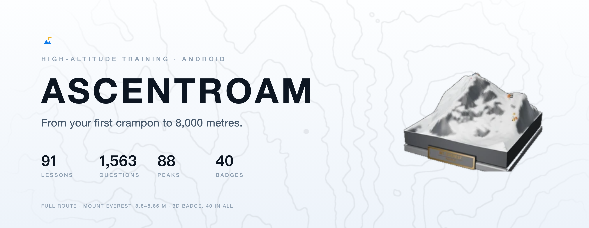
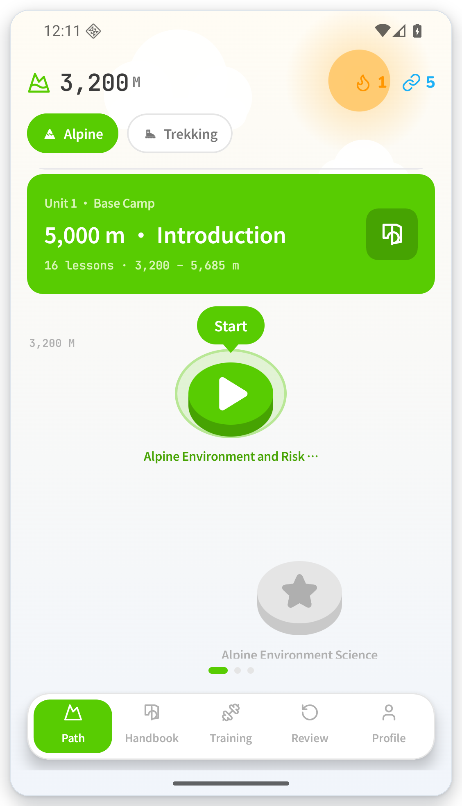
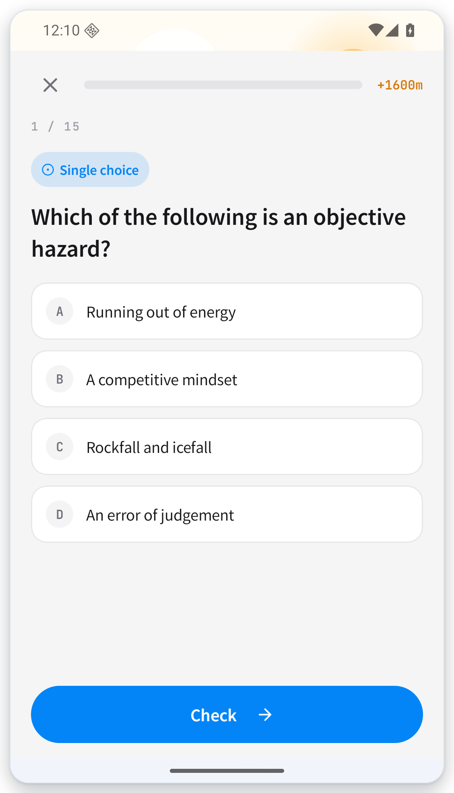
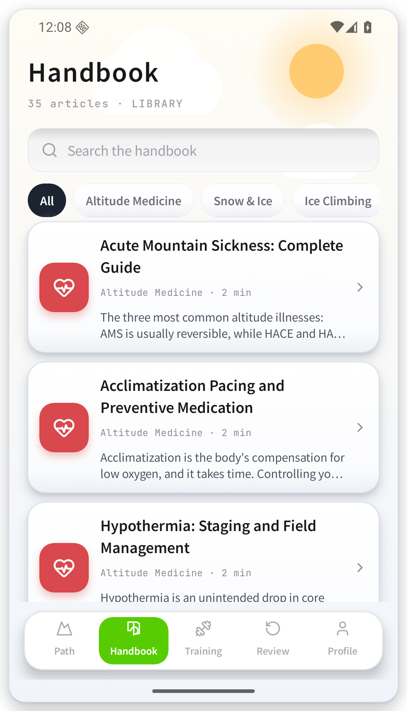
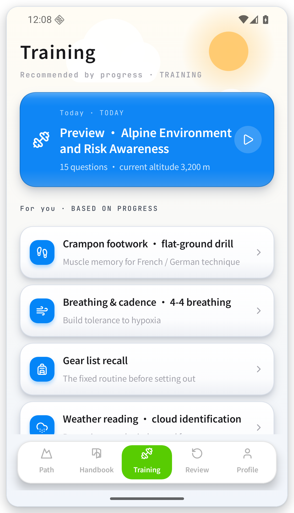
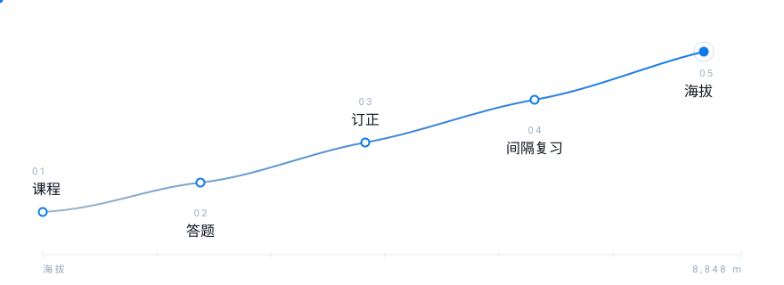
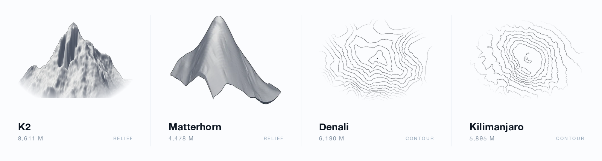

<p align="center">
  <picture>
    <source media="(prefers-color-scheme: dark)" srcset="assets/readme/hero-dark.png">
    
  </picture>
</p>

<br>

<p align="center">
  <a href="https://github.com/Solar-CV/AscentApp/releases"></a>&nbsp;
  <a href="https://ascentroam.com/support"></a>&nbsp;
  <a href="https://ascentroam.com"></a>
</p>

<br>

<p align="center"><sub>
<a href="README.md">English</a> · <a href="README.zh-CN.md">简体中文</a> · <a href="README.zh-TW.md">繁體中文</a> · <a href="README.ja.md">日本語</a> · <a href="README.de.md">Deutsch</a> · <a href="README.es.md">Español</a> · <a href="README.fr.md">Français</a> · <a href="README.it.md">Italiano</a> · <a href="README.ru.md">Русский</a> · <a href="README.sv.md">Svenska</a>
</sub></p>

一个给高海拔攀登和攀冰新手做的 Android 应用。课程按海拔组织：每过一课，海拔往上走一段。

<p align="center"><sub><b>当前版本 v0.28.8</b>（versionCode 166）· Android 8.0+ · arm64-v8a · 约 41 MB</sub></p>

<p align="center">
  &nbsp;
  &nbsp;
  &nbsp;
  
</p>

<p align="center"><sub>路径 · 答题 · 技能书 · 训练 —— 英文界面，浅色主题</sub></p>

<br>


## 攀登这条路

两个课程大类可以自由切换：**高山攀登** 6 个单元、69 课，从 5,000 米入门排到 8,000 米，走完海拔从 3,200 m 到 8,848 m；**徒步** 4 个单元、22 课，从一日徒步排到长线，走完海拔从 200 m 到 5,630 m。两条大类的进度、徽章与复习队列各自独立。

首页是一条从大本营往上的路，按海拔切成单元，每页两个。课程线性解锁：过一课，下一课才开。节点上标星级，当前课挂着「开始」提示，单元最后一课是金色。

每一课都走同一个循环：先读，再答，答错的当场订正，过几天再回来一次。



进度不是一个存下来的数字，而是由已完成的课程重新算出来的；以后调整海拔曲线，旧存档会重算，不会卡死。

## 真实的山



学习进度现在有了形状：一路往上爬，沿途会解锁真实的雪峰，共 88 座，从 3,600 米的贺兰山到 8,848.86 米的珠峰。每座都有自己的地形图，按真实高程数据画：模型撑得住就出立体晕渲，撑不住就画等高线。卡片上写着真实海拔、所在山脉与八千米排名。

路径页顶部那张卡永远显示当前海拔对应的那座，并告诉你还差多少米。「我的 → 当前海拔」里有完整图谱；已解锁的点进去看卡片，每座都写了「关于这座山」，只写走这条路真正要知道的事。

## 四十枚徽章，都是实体


四十枚成就全部是实时 3D 实体徽章：金属边框、珐琅嵌片、浮雕，用 Filament 渲染。点开任意已解锁的徽章是全屏的：拖动旋转，双指捏合放大到约 5.5 倍，两根手指平移看浮雕，双击复位，停手后自己轻轻晃。墙上的图标就是模型自己渲出来的，墙与 3D 视图是同一个物体。任何时候解锁，都用同一套渲染，浅色展台，彩带从屏幕两侧喷进来。

## 里面有什么

**题库。** 1,563 道正式题，加 158 道自动插入的复习副本，共 1,721 条展示项。题量随海拔递增：5,000 米入门每课约 15 题，7,000 米技术单元 30 题，徒步 8 题。八种题型：单选、多选、排序、匹配、填空、计算、热点（在图上点位置）、情景（一个题干分几步答）。

一课做完直接进入错题重做：当次答对的记入掌握，剩下的进复习中心，按 0、1、3、7、16、35 天间隔重复。安全相关的题加权，必须确认「我明白了」才能继续。

**技能书。** 35 篇长文，每篇 4–8 节，分到装备、技术、医学、健康、天气、气象、决策、判断、安全、风险、雪崩救援十一类。按轨道分开：冰雪类只在攀登下出现，高原医学、失温、导航、露营、领队两条轨道共享。

**训练。** 推荐下一课，另有四个练习：五分钟 4-4 呼吸节拍、四组 30 秒冰爪步频、装备清单回忆、看云识天气。两个小测都从已有课程里抽单选题，每轮打乱选项，答完立刻给解析。

**设置。** 外观跟随系统或固定浅色 / 深色；语言跟随系统或手动指定，界面与内容即时切换，不用重启。关于里有隐私政策与服务条款（都能离线读）、给应用评分、复制分享链接，以及一个「支持 AscentRoam」入口——在浏览器里打开赞助页，App 内不出现任何支付平台。「开发者模式」藏在版本号后面，点七次出现。

**反馈。** 我的 → 反馈与建议：选类型、写内容、可留邮箱、可附诊断信息。发送直接到维护者；网络不通时提供「改用邮件发送」，没有邮件应用就把正文复制进剪贴板。诊断默认关闭，不含课程正文、答题记录与账号。

## 十种语言

简体中文（原文），繁體中文、English、日本語、Deutsch、Français、Español、Italiano、Русский、Svenska

十种全部齐全。每种语言都有自己的入口层、课程要点、技能书正文与题库，键集合与英文逐条对齐——**10,727 / 10,727**，不缺、不重、没有孤儿键。

| 层 | 条目 | 九种翻译语言 |
|---|---|---|
| 入口（课程名、单元名、技能书标题、山峰名） | 296 | 100% |
| 课程要点 | 451 | 100% |
| 技能书正文 | 378 | 100% |
| 题库（题干 / 选项 / 解析） | 9,602 | 100% |

术语按各语言自己的登山习惯走，不做字面直译：瑞典语 stegjärn / isyxa / standplats，德语 Steigeisen / Pickel，俄语 кошки / ледоруб，意大利语 corda fissa / bloccante / sosta。医疗剂量、雪崩等级、坡度与温度一律照原文搬，只改数字写法，三套约定刻意分开：

- 中、英、日：`6.5 °C`、`5,000 m`
- 德、西、意：`6,5 °C`、`1.000 m`
- 法、瑞典：`6,5 °C`、`5 000 m`

面向学习者的语气也各按母语来：德语用无人称的 *man*，西班牙语称 *tú*，法语称 *vous*，瑞典语与意大利语称 *du* / *tu*。万一某条缺了，回退顺序是 当前语言 → 英文 → 中文原文；这条路径现在只是保险。

## 课程怎么排

**高山攀登**

| 单元 | 海拔 | 课数 | 题数 | 每课 |
|---|---|---|---|---|
| 5000M · 入门 | 5,000 m | 16 | 249 | 16 |
| 5000M · 进阶 | 5,300 m | 12 | 221 | 18 |
| 6000M | 6,000 m | 15 | 336 | 22 |
| 7000M · C3 技术营 | 7,000 m | 6 | 185 | 31 |
| 7000M · C4 高营 | 7,500 m | 10 | 279 | 28 |
| 8000M | 8,000 m | 10 | 248 | 24 |

**徒步**

| 单元 | 海拔 | 课数 | 题数 | 每课 |
|---|---|---|---|---|
| 一日徒步 | 1,200 m | 5 | 40 | 8 |
| 多日与露营 | 2,500 m | 9 | 93 | 10 |
| 高海拔徒步 | 3,800 m | 5 | 44 | 8 |
| 长线与应急 | 4,500 m | 3 | 26 | 8 |

目标山峰与路线共 38 个：攀登 30 座，从 5,211 米的奥太娜到十四座八千米；徒步 8 条，从徽杭古道到珠峰三条垭口。

## 装到手机上

Google Play 上架了，[从商店装](https://play.google.com/store/apps/details?id=com.ascentroam.app)最省事，装完能自动更新。不想用商店就装 [Releases](https://github.com/Solar-CV/AscentApp/releases) 里的预编译 APK——推一个 `v*` tag，GitHub Actions 会构建并把新 APK 挂上去。

- 包名：`com.ascentroam.app`（源码包名仍是 `com.ascent.climb`）
- 最低：Android 8.0（API 26），**仅 arm64-v8a** —— 只有 32 位的手机装不了
- 体积：约 41 MB（徽章模型未压缩 38 MB、打包后约 9 MB；其余是题库、地形图与原生库）
- 签名：v0.21.2 起为正式签名。装不进旧 debug 包，得先卸载——本地进度、徽章与设置会一起清掉
- 权限：网络与网络状态——用于检查题库更新和发送反馈。其余功能全部离线可用，随包题库一直在

把 APK 传到手机，允许「安装未知来源应用」，点安装。首次启动不用登录。

## 架构



四层，每层只认识下面那一层。界面不直接读内容，学习模型从内容重算，平台层决定要不要换新题库，其余时候不插手。

- **离线优先。** 题库随包分发；在线那份只在比本地新时才覆盖缓存
- **内容是数据。** 课程、题目、技能书正文与译文都在 `data/` 里，不在界面里：加一个单元就是加数据条目，再在 `Curriculum.kt` 里写一行
- **两个可选服务。** 题库更新与账号同步都可以不存在，其余功能不依赖它们

<details>
<summary><b>项目结构</b></summary>

```
AscentApp/
├── import/                      题目编写（Markdown，来自纸质书）
├── knowledge/                   纸质资料知识库
├── tools/
│   ├── contentcheck/            内容检查 + 题库导出（纯 JVM）
│   ├── i18ncheck.py             四层内容 × 十种语言的覆盖率
│   ├── qbank/build.mjs          Markdown → 题库编译器
│   ├── readme/                  README 素材（横幅、图、截图套框）
│   └── poc3d/                   模型同步、图标抠图、自发光烘焙
└── app/src/main/
    ├── res/values*/             十种语言的界面文案
    ├── assets/
    │   ├── badges/*.glb         40 个徽章模型
    │   └── env/studio_ibl.ktx   程序生成的 IBL 环境
    └── java/com/ascent/climb/
        ├── data/
        │   ├── Unit1~5.kt       主体课程内容
        │   ├── NewLessons.kt    新增课程的正文
        │   ├── i18n/Pack*.kt    内容译文（入口 / 要点 / 技能书 / 题库）
        │   ├── Diagnostics.kt   崩溃日志 + 环境快照，供反馈表单使用
        │   ├── FeedbackSender.kt  Formspree POST（HttpURLConnection，无额外依赖）
        │   ├── BundledBank.kt   课程池组装与复习插入
        │   └── bank/            题库配置、JSON 解码、网络、仓库
        └── ui/                  页面与组件（Badge3D.kt = Filament 场景、取景、灯光）
```

</details>

## 自己构建

整套工具链都可以放在家目录里，不需要 Homebrew，也不需要 Android Studio。这台机器上用的是：

- `~/android-toolchain/jdk`：Temurin OpenJDK 17
- `~/android-toolchain/sdk`：Android SDK，含 platforms;android-36、build-tools;36.1.0、platform-tools
- `~/android-toolchain/gradle-8.11.1`：Gradle 8.11.1

```bash
export JAVA_HOME="$HOME/android-toolchain/jdk/Contents/Home"
export PATH="$JAVA_HOME/bin:$PATH"
export ANDROID_HOME="$HOME/android-toolchain/sdk"

cd AscentApp
"$HOME/android-toolchain/gradle-8.11.1/bin/gradle" assembleDebug
```

仓库也带着 Gradle 8.11.1 wrapper，没装 Gradle 的机器也能直接跑：

```bash
cd AscentApp
./gradlew assembleDebug
```

产物在 `app/build/outputs/apk/debug/app-debug.apk`。上 Google Play 要打 App Bundle：`./gradlew bundleRelease` → `app/build/outputs/bundle/release/app-release.aab`。AAB 装不到手机上，侧载仍然用 APK。

### 改内容

往已有课程里加题，改 `data/Expansion*.kt`。要新增一课，在 `data/NewLessons.kt` 里写 `Lesson(...)`，再把它的 id 加进 `Curriculum.kt` 的对应单元——顺序与单元归属只认 `Curriculum.kt`。

```bash
bash tools/contentcheck/run.sh
python3 tools/i18ncheck.py
```

第一个脚本把应用内容同步成一个纯 JVM 工程，跑真实的组装逻辑，检查题数、难度递进、越界答案、空题、解锁逻辑与成就定义，最后导出 `bank/bank.json` 与 `bank/manifest.json`；第二个报每种语言在四层上的覆盖率并比对键。两个都不需要模拟器。动过题库后记得改 `data/bank/BankConfig.kt` 里的 `BUNDLED_VERSION`。

## 题库在线更新

题库有三层来源：本地缓存、随包内置、在线增量。实际取用顺序是缓存 → 内置；在线那份只在比本地新时才覆盖缓存。所以飞机上、山里没信号、服务端挂了、JSON 格式错、sha256 不匹配、版本更旧，这些情况都只会保留现状。启动后静默检查，距上次超过 6 小时、且已经配置地址才发请求。

发布一份新题库：改内容 → `BUNDLED_VERSION` 加一 → 跑 `contentcheck` → 把 `bank/bank.json` 和 `bank/manifest.json` 传到服务器或 CDN → 下次打开 App 自动更新，不用发版。

旧版 App 不会被新题库搞崩。`manifest.json` 里的 `minAppVersion` 会拦住版本不够的客户端，未知字段直接忽略，单条题目格式错误只跳过那一条。

## 内容从哪来

公开资料包括荒野医学协会 2024 版急性高原病临床实践指南、CDC Yellow Book、美国高山向导协会（AAI）与美国高山俱乐部（AAC）的技术资料、REI Expert Advice、UIAA 与 CE 装备标准，以及 avalanche.org 的雪崩数据。第二股是 SEVEN SUMMIT TREKS 的三份向导文档——高原病、装备、一般远征实务。再往后，七本中文登山书的校对稿被编进技能书：知识与案例用自己的话重写，标注页码；扫描原文不进仓库。

| 来源 | 用途 |
|---|---|
| WMS / CDC / StatPearls | 高原医学题目与技能书 |
| AAI / AAC / REI / BMC | 冰雪与行进技术 |
| UIAA / CE 标准 | 装备题目 |
| avalanche.org | 雪崩判断 |
| SEVEN SUMMIT TREKS 文档 | 技能书 h17–h22 及相关题目 |
| 7 本中文登山书 | 技能书 h23–h31 |

## 安全边界

应用只覆盖理论与认知准备。实操技能——冰雪、结组、攀冰、救援——必须由持证教练在现场教并考核。这里没有医疗建议，用药与急救的决定属于医生。不承诺登顶，也不保证适应结果。标注「需教练」的课程，在理论部分结束后会明确说明。

## 最近改了什么

<details>
<summary><b>发布说明：v0.28.8 往前到 v0.13</b></summary>

**v0.28.8：设置补齐、徒步地形图，两处修正**

- 设置补齐了该有的东西：服务条款（可离线阅读）、给应用评分、复制分享链接，以及一个「支持 AscentRoam」入口——点开在浏览器里打开赞助说明，App 内不出现任何支付平台
- 键盘弹起不再把底部导航栏一起顶上去；右上角的天气日轮对准了连续天数，不再压住旁边的绳索图标
- 徒步路线配上地形图：44 条里 39 条能看到山脊、河谷与海岸线，还有路线本身的走向，直接替换掉卡片上原来的海拔剖面。长线叠淡晕渲；几百公里的朝圣之路、JMT 这类改用只画走向的示意画法，标出关键城镇
- 88 座山峰都有「关于这座山」，44 条徒步都有「关于这条线」，与路线名一起补齐九种语言；徒步百科按界面语言把你所在的大区排在最前面

**v0.27.1 – v0.27.2：界面跟着天气变**

- 背景会跟着天空走：晴、阴、雨、雷雨、雪。晴与阴是静态，雨 / 雷雨 / 雪有动画；夜间太阳换成月亮，整套配色转深色
- 设置 → 外观新增「天气背景」开关：打开后跟随所在地天气（只请求一次粗定位），关掉则固定晴天。默认关闭，不开不影响任何功能
- 天气数据来自 Open-Meteo，本机缓存 3 小时；隐私政策已在两处补上说明
- 全应用的圆角改成了 squircle（连续曲率）——胶囊按钮、卡片、底栏。尺寸与配色都没变，只是直边与转角交接处不再「顿」一下

**v0.27.0：支持 Google 一键登录**

- 登录页多了「使用 Google 继续」：Credential Manager 取回 ID token，服务端验票后登录，首次登录自动建号
- 首次登录会把 Google 的昵称与头像带过来——头像下载后按 1:1 裁方，走与手动上传同一条同步路径
- Google 只是捷径，不是必需：邮箱注册、登录与找回密码都没变，不登录、断网照常可用
- 手机没有 Google Play 服务、或取消选择账号时，会给一句明确说明，而不是笼统的「登录失败」

**v0.26.9：德语底栏不再被裁字**

- 复习标签原先借用页面标题（德语 Wiederholung，12 个字符），比底部槽位宽，最后一个字母被圆角裁掉。现在改用底栏专用短标签，德语显示为「Üben」

**v0.26.7 – v0.26.8：条款补齐了反馈，数据也认得了主人**

- 隐私政策补上「App 内反馈」：提交时会收到你写的正文、你选择填写的邮箱，以及**只有主动勾选才会附上**的诊断信息（应用版本、Android 版本、设备型号、界面语言、最近一次崩溃记录）。条款版本 2026-11-05，已同意过的不需要重新同意
- 头像跟着账号走：退出登录后立即从界面消失；换账号登录看到的是新账号的头像（没设过就是字母占位），不会沿用上一个账号的
- 修掉一个隐蔽的问题：删掉头像后重新上传，云端版本号会从 1 重来，别的设备因此永远收不到新头像
- 学习进度也按账号隔离：只退出登录时本机进度保留、离线照常学；重新登录同一个账号正常合并；登录另一个账号则用云端数据覆盖本机，不再把上个账号的进度带过去

**v0.26.6：注册前先同意隐私政策**

- 注册账号前必须勾选同意隐私政策。全文（10 节）打包在应用内，离线可读，不是网页壳；提供简体中文、繁體中文与英文，其余界面语言回退英文
- 随时可在「设置 → 关于 → 隐私政策」重读；登录与找回密码不会再次询问

**v0.26.4 – v0.26.5：已登录设备，开屏与图标对齐**

- 设置 → 账号新增**已登录设备**：逐台列出平台、版本与最近使用，可单独撤销；当前设备也能撤销，确认框会说明「会退出登录、进度不丢」
- 开屏字标的山顶旗子原来是高瘦三角：路径 x 乘了缩放系数、y 漏乘。修正后与桌面图标逐点一致；历史遗留的 `ic_splash_mark` 也按同一网格重画
- 设置里的长副标题不再把行撑高——标题与副标统一限一行，另把七种语言的副标改短（意大利语原来会把版本号本身截掉）
- 「我的」页去掉了成就徽章入口，徽章统一在个人主页看

**v0.25.0 – v0.26.3：账号上云，换了个名字**

- 账号是真云端了：邮箱注册 / 登录，进度与头像同步，换设备登录就能找回。仍然可选——不登录、断网都能完整使用
- 本地资料：头像选完进 1:1 裁剪页（双指缩放、拖动、旋转），用户名可改；解码时按 EXIF 摆正，竖拍照片不再躺倒
- 设置 → 账号里可以删除账号，确认框逐条列出删什么（服务端记录、进度、徽章、头像、用户名）与保留什么（主题、语言、轨道）
- 「重置学习进度」收进设置并加了确认框，且不再顺手清掉用户名、头像与界面语言
- 品牌从 ASCENT 更名为 **AscentRoam**（ascentroam.com），包名改为 `com.ascentroam.app`——可与旧版共存，但在手机上是两个独立应用
**v0.24.0：为上架 Play 做准备**

- 每个 Release 现在附两个文件：侧载用的 APK，和传 Google Play 用的 `ascent-<tag>-release.aab`
- 16 KB 内存页：查过了，不用改。四个原生库（Filament、gltfio、filament-utils、androidx.graphics.path）的每个 `PT_LOAD` 段都已按 0x4000 对齐，APK 里也是未压缩 + 16 KB 对齐
- `targetSdk` 34 → 36，`compileSdk` 同步；AGP 8.5.2 → 8.9.2，Gradle 8.9 → 8.11.1。API 35 起系统强制 edge-to-edge，所以改成显式 `enableEdgeToEdge()` + 根布局留出 `safeDrawing` 安全区，不再依赖状态栏配色属性
- 新增 `tools/check_16k.py` 与 CI 校验：16 KB 不通过、或 targetSdk 低于 35，直接不发版
- 3D 徽章展示页的帧率、后端、泛光档位只在开发者模式下显示，普通用户不会再看到那一行调试信息
- 成就测试区的单项重置改为二次确认（4 秒内不确认自动撤回），误触不会再清掉徽章
- debug 包改用独立包名（`com.ascent.climb.debug`），可以与正式版装在同一台手机上共存

**v0.23.3：云图课补到 18 / 12 题**

- 攀登版自主题 6 → 18、徒步版 5 → 12，题题不同图；图库从 7 张扩到 31 张（NOAA NESDIS + NWS 公开云图）
- 补上卷积云、高层云、层积云、塔状积云、穿孔云、碎云、弧状云、墙云、河谷辐射雾、飞机尾迹；同一类云配两三张不同照片，问法分「识别 / 趋势 / 该怎么做」
- 天气判读题池 63 → 68；答完题停在解析卡顶部，高图不会再被推出屏幕

**v0.23.0 – v0.23.2：首启引导与云图课**

- 首次安装只问两件事：攀登还是徒步、界面语言（即时预览，按继续才保存）
- 锁定竖屏；开发者模式「显示正确答案」覆盖训练页
- 新增两节「看云识天气」课；训练页支持题图与全屏放大

**v0.22.0：训练页真的能练了**

- 两个训练上线：5 分钟 4-4 呼吸节拍器（8 秒一个循环，余弦缓动），和 4 组 × 30 秒冰爪步伐节奏（1.2 秒一步，左右交替）
- 都按**实际时长**记账：提前按结束时记的是已练时间，不是满时长；不足 15 秒不入账，避免误触污染累计
- 装备默写与天气判读标为「即将上线」，不再是无反应的死行

**v0.21.2：正式签名构建** —— Releases 里的包改为 release 签名 + R8 压缩，体积从 41 MB 降到 30 MB。装到已有调试版的机器上要先卸载，会清本机数据。

**v0.21.1：三处修复**

- 除简体 / 繁体之外，各语言下技能书都是空的。「全部」筛选把界面文案当成了筛选值，切语言后旧值既不等于新的「全部」、也不等于任何分类名，35 篇全被滤掉
- 法语、西语下底部标签被截断：选中态近乎正圆，13 个字符的单词顶出形状。改成圆角块，字号按最宽的一项整排自适应
- 外框圆角不再切掉最左 / 最右选中项的边角——外层圆角收进「内边距 + 内块圆角」之内

**v0.20.19 – v0.21.0：黏土质感**

- 卡片换成黏土：每块四层——外投影、贴边光、顶部一截高光、内底压暗；阴影用 `BlurMaskFilter` 离屏画出、按尺寸与圆角缓存。`Modifier.blur()` 要 API 31，本工程最低 26；`Modifier.shadow()` 又做不了带颜色的双层影
- 五个页面重做：个人主页、复习、训练、技能书，随后是「我的」页。高光收成顶部 20dp 的贴唇，描边从 1 物理像素改成 dp，投影拆成体积影 + 接触影——在这之前卡片看着像半透明，原因是高光把边缘吃掉了
- 技能书按分类上色（装备钢蓝、绳索青、冰雪靛、医学红、判断琥珀、行前绿、领导力品红），色块是纯平色不画渐变，详情页封面也跟着分类走
- 连续解锁多条成就时不再叠影：3D 视图按成就 id 重建，弹窗之间的遮罩常亮

**v0.20.18：攀登大满贯换了新模型**

- 珠峰地形摆件重新导出，主要在打磨细节：经幡旗片从 0.20 mm 放大到 0.42 × 0.26 mm（原来手机上根本看不见），绳端用两层叠石托高、旗片逐片校验离地，小部件改成直接对地形网格采样
- 图标按新的 hero 渲染重出；姿态与取景逻辑未变

**v0.20.17：修掉误触发的甩动**

- 双指松开一根手指时，原来会被当成"单指拖动"接着算，而基准点还在两指中心——模型会跳一大步，并把这次跳变带进惯性甩出去。现在手势改成显式状态机：双指开始后剩下的手指一律忽略，松手也不留惯性
- 放大查看时不再自动摆动；回到正面也改成平滑扫过，不再瞬间跳转

**v0.20.16：放大看局部**

- 双指缩放原来最多只到 1.25 倍，峰名、海拔这些小字在手机上根本读不清；现在能放到 5.5 倍
- 两指间距不变时拖动是平移取景，可以走到边角看局部；单指拖动仍是旋转。双击把缩放和平移一起复位，徽章标题下方也加了一行手势提示

**v0.20.15：40 枚徽章全部有模型**

- 最后六枚到位：八千米毕业（学位帽牌）、终极考核（登顶纪念牌）、六区足迹（跑鞋大底）、十四座八千米（2.5:1 全景横牌）、双线并进（双轨托盘）、攀登大满贯（珠峰地形摆件——全系唯一不是徽章的一件）
- 四十枚的图标现在全部由模型自身渲染，墙上那批手绘/AI 备份彻底退役
- 攀登大满贯要单独定姿态：它是立在底座上的摆件，套不了扁平徽章那条 90° 翻转，改成绕 Y 轴把铭牌转向镜头；它的渲染是灰底不是黑底，抠图也跟着按灰底处理
- 模型 34 → 40 枚，包体 39.4 → 40.6 MB

**v0.20.14：徽章随处可点开**

- 不再只有开发者测试区能看 3D：在「我的 → 头像 → 已解锁徽章」或「全部徽章墙」里点任意已解锁徽章，直接全屏打开。展示页盖在 App 之上而不是替换页面，所以返回时回到原处、列表位置不丢，底部导航栏也不会压住徽章
- 徒步毕业的模型早就进来了，图标却还指着共用占位图；现在指向模型渲染图
- 双线并进原来的图标是一张真人照片（遗留占位图），现在换成程序画的徽章盘（深蓝珐琅 + 黄铜框 + 两条汇到峰顶的虚线），那张照片也从包里删掉了

**v0.20.13：徽章模型增至 34 枚**

- 新增六枚：6,000 米的学习、卷土重来、七天足迹、三周足迹、二十次跑课、安全第一（D 形主锁）；`self_arrest` 换成新导出的 v4
- 图标抠图补上「被外形围住的背景」：卡扣中心孔、冲孔卡片的通孔以前是实心黑块，现在能透出底色。逐块判断——与背景同色且整块均匀才算孔，带渐变的深色区域不动。包体 38.5 → 39.4 MB

**v0.20.11：3D 徽章展示页的布光与背景**

- 展示页原来只有两盏灯，金属只有一道弧面高光、浮雕发平。现在拆成五盏方向光——主光、顶光、正面柔光、轮廓光和一点底部反弹光，总照度保持不变，所以层次多了但不会整体发白
- 另做了一张更暗的背景（合成波落日，重度模糊到只剩色场）适配暗色主题。右上角胶囊在亮底 / 暗底之间切换，默认跟随系统并记住选择，只影响这一页

**v0.20.8 – v0.20.10：开屏**

- 开屏改成黏土拟态：白底、边缘收紧的圆盘、单峰山标；原来那句「学习进度 = 海拔」换成一句随机的登山界名言（马洛里、温珀、缪尔、布克列夫、维斯特斯、田部井淳子、梅斯纳尔、洛、博纳蒂），约 1.7 秒后淡出，开启「减少动态效果」时几乎直接跳过。App 内其余界面未改动 v0.20.9 起系统启动画面不再显示任何图标：启动主题只用与开屏一致的底色，点开就是一片白（深色下近黑），紧接着圆盘落下. 每句都用他本人的原话原文，不做翻译

**v0.20.6 – v0.20.7：徽章画质**

- 泛光默认跑最高画质：256 px、四层、MEDIUM。旧逻辑从第一帧就开始统计，着色器编译的几百毫秒足以把它一路判死，之后稳定 60 fps 也回不来。现在先跳过 2.5 秒预热，阈值放宽到 50 ms（20 fps）并要连续三个窗口，降档分成「完整 → 低配 → 关」三档
- 4x MSAA 在驱动支持时默认开启，建交换链前先查能力；一旦建链失败就退回无 MSAA 并记住这次失败，不会因为一个抗锯齿参数让徽章画不出来

**v0.20.4 – v0.20.5：小修**

- 开发者模式在解锁前完全不可见——设置页整块（含「未开启 · 连点版本号 7 次」）对普通用户不渲染。连点 7 次的计数器仍然有效，只是不再显示还剩几次
- 成就测试区里也能保住滚动位置了：点进某枚徽章的 3D 展示再返回、从设置页进测试区再返回，都停在原处
- 成就弹窗不再被误触关掉：点边框第一次只是「上膛」并淡入「再点一次关闭」，第二次才关。「收下」按钮和返回手势仍是一步关闭

**v0.20.0 – v0.20.3：3D 徽章**

- 34 枚成就改为实时 3D 渲染（Filament 1.75 + glTF，金属与珐琅按 PBR 材质走）。拖动旋转、双指缩放，静置后正面轻微摆动；自动展示不转整圈，因为奖章背面是一块素板
- 40 枚现已全部有模型（v0.20.15 收官）；透视卡片回退保留给以后的新成就
- 解锁弹窗与测试区预览弹窗走同一套渲染；模型下面垫浅色圆盘（深色模型贴在深色卡片上会糊成一块），同时从屏幕两侧喷 56 条彩带。系统「移除动画」开启时不喷
- 展示页背景换成重模糊风景，程序生成（27 KB）：天空、四层山脊、雾带，没有图片版权问题
- 按反馈反转了拖动方向；整体提亮后略微回收，给自发光留对比空间
- 模型自带的光效终于生效：`KHR_lights_punctual` 的光源实体不会随 glTF 资产实体进场景，必须单独加入，且要把强度放大到与场景曝光同一量级（54 cd 对 66,000 lux 的主光，不放大等于没开）；`KHR_materials_emissive_strength` 在构建期烘进 `emissiveFactor`；泛光打开，帧时间连续超过 28 ms 时自动关闭
- 模型库从 17 枚扩到 **34 枚**：连击、完美、复习、撤离、徒步毕业、海拔、卷土重来、周足迹、跑课、主锁等新增，冰爪出师/好奇开发者/完美系列重新导出；包体 21 → 39 MB
- **成就图标改由模型生成**：每枚徽章取正面渲染图，把纯黑背景抠成透明，输出 256px 图标。徽章墙、解锁弹窗、3D 视图看到的是同一个物件，这批的 AI 插画已弃用
- 聚光灯增益收敛到 5×（模型自带的聚光本就朝徽章内部打，放大多少都照不到正面，需要在 Blender 源文件里修），泛光降到 0.05
- v0.20.3：列表滑到中间、进二级页（设置→语言、技能书→文章、我的→设置、复习→课程）再退回来，位置不再弹回顶部；从课程返回也不再强制把路径页翻回第一页

**v0.19.25 – v0.19.30：App 本身的修改**

- 成就系统与 89 课题库对齐。`full_route` 从「66 课」改成「攀登 68 课全通」——原来还按当前轨道判定，徒步走完 21 课就能拿到「理论大满贯」；`five_zones` 改成「六区足迹」，与攀登 6 个单元对应。新增 5 枚徒步成就，总数 35 → **40**
- 成就进度改为跨轨道统计，不再随当前选中大类上下浮动
- 大类图标重绘为实心剪影（雪山 / 登山靴），替掉弹层里的 `▲` / `≡` 文本字符；顶部胶囊也加了同款 14dp 图标
- 开屏标记缩小 40%
- 新增反馈页（Formspree 直投 + 邮件与剪贴板退路）与崩溃记录（只留最近 5 条，默认不上传）
- 修正「我的」页与个人主页的路线进度口径：分子曾是两条轨道完成总数、分母是当前轨道课数，切轨道后会显示「68 / 21 课」

v0.19 是内容扩充，题库结构与判分逻辑没动。

- 课程 47 → 89 课：攀登补到 68 课（6000 / 7000 / 8000 米三个单元、14 座 8000 米峰），新增徒步轨道 21 课
- 题目 711 → 1,533 道（9,422 条 key），技能书 31 → 35 篇（雪崩埋压与复苏、雪崩三件套、固定绳、渡河），题库 v15 → v19
- 内容层**九种语言**做到四层全量：英文、繁體中文、日文、俄文、德文、西班牙文、法文、瑞典文、意大利文，键集合与英文逐条一致（10,554 / 10,554），运行时不再回退
- 人称按各语言习惯：德文无人称 man-Form、西文 tú、法文 vous、瑞典文与意文 du / tu；数字也各自本地化——德 / 西 / 意用千位点 1.000 m，法 / 瑞典用千位空格 5 000 m
- 早前删过带上下文的情景题，留下 5 条孤儿键（`q.l2#5.c`、`m15#17.c`、`m16#18.c`、`m16#22.c`、`m16#24.c`），九种语言在这一轮里全部清掉，键集合回到干净状态
- 繁中走 OpenCC s2twp 加术语表，并用既有译文做回归校验（复现差异 0）；日文是真翻译，题库与技能书分两种语体
- `tools/i18n/` 三个命令（`status.py` / `prep.py` / `apply.py`）在九种语言上通用，繁中另有 `tw.py`、`tw_entry.py`
- 题库按文件拆：单个 Kotlin 文件约 2,500 条会让编译器崩，九种翻译语言各拆成三支（`Pack*Quiz.kt` / `Quiz2` / `Quiz3`）

v0.16 到 v0.18 都是多语言，没有改题库结构和判分逻辑。

- 界面文案拆成 10 套 `res/values*`，语言可在设置里手动指定，也可跟随系统，切换即时生效
- 内容层新建 `data/i18n/`，按语言分四个包：入口、要点、技能书正文、题库。每种语言合计 4,727 条
- 9 种翻译语言（繁中、英、日、德、法、西、意、俄、瑞）四层全部完成；除英文外的 8 种逐 key 对英文源做差集校验，缺项 0
- 术语按各语言既有说法统一，医学剂量、雪崩等级、坡度、气温等数字原样保留
- 新增 `tools/i18ncheck.py`，一条命令看完四层覆盖率，避免「翻完了但漏了某课」这类问题
- 顺带修了若干文案问题：一处逗号加破折号的标点错误（瑞典语 140 处、德语与西语各 5 处）、两处填空答案多出引号、法语三个小数的写法

再往前：

- v0.15.1：应用内文案清理，去掉字面 `**` 标记，重写一批解析，登录页不再承诺未实现的同步
- v0.15.0：技能书补 9 篇中文书籍篇（h23–h31），新增「户外领导力」分类，22 → 31 篇
- v0.14.0：补 6 篇 SEVEN SUMMIT TREKS 向导内容
- v0.13.x：设置页、个人主页、全部徽章墙；次级页面接入返回手势

</details>

## 支持 AscentRoam

AscentRoam 是个人独立开发的免费开源户外学习项目，没有广告，也没有付费解锁。如果它对你有用、你希望它继续被开发和维护，可以通过 [爱发电](https://afdian.com/a/ascent) 或 [Ko-fi](https://ko-fi.com/ascentroam) 自愿支持。

**所有支持都是无偿赠与，不换取任何权益**：不买额外功能、不买数字内容、不买专属徽章，也不换取任何其他东西。所有人拿到的都是同一个应用。


## 许可

PolyForm Noncommercial License 1.0.0，仅限非商业用途。商业使用需另行书面授权，详见 `LICENSE` 与 `NOTICE`。
